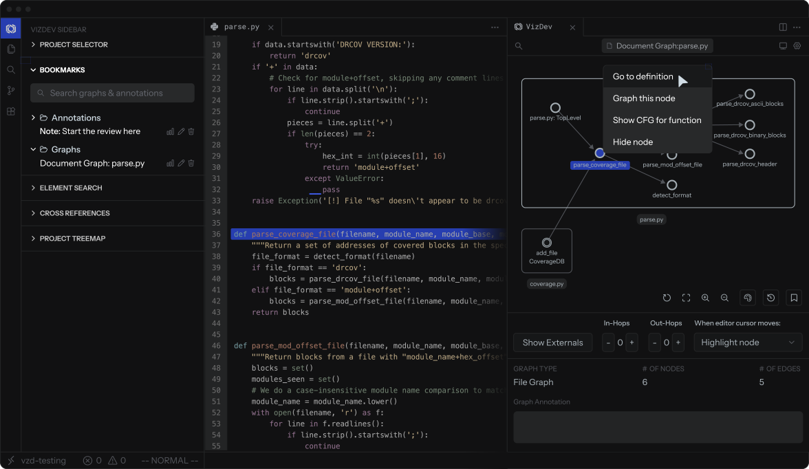
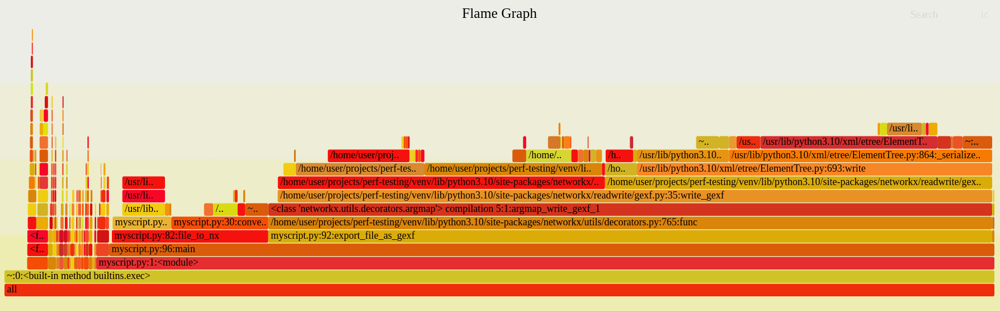
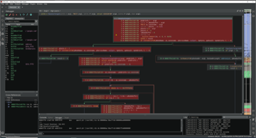
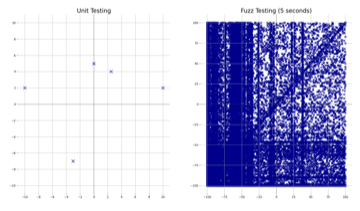
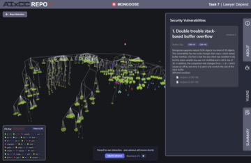
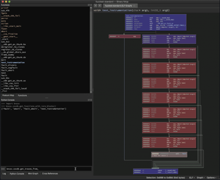
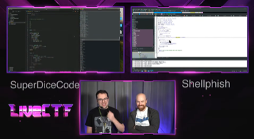

Hey there, I'm Mark 👋

I like to figure out how things work, share things in a way that makes them easier to understand, and invent new methods that are more intuitive/visual.

### 🧑‍🚀 What I'm building: [VizDev](https://vizdev.com)

VizDev: interactive visuals for code, so you can see, explore, and understand codebases graphically, instead of getting lost in text.

It's also built to make coding with AI easier, because it gives you visual ways to collaborate and communicate with agents.

It's in closed beta right now, so [come take a look](https://vizdev.com) if you want to help make a better way of working with code.

### 💡 Blog: [seeinglogic.com](https://seeinglogic.com)

Looking at where development, security, and visualization meet. Selected posts:

<table>
<tr>
  <td width="200" valign="top">
  
  </td>
  <td valign="top">
  <b><a href="https://seeinglogic.com/posts/flame-graphs-explained/">Flame Graphs Explained</a></b> 
  How to make flame graphs for Python and use them to find performance problems fast.
  </td>
</tr>

<tr>
  <td width="200" valign="top">
  
  </td>
  <td valign="top">
  <b><a href="https://seeinglogic.com/posts/binary-ninja-ttd-intro/">Next-Level Reversing: Binary Ninja + TTD</a></b> 
  Coverage makes time-travel debugging easier to use, which wasn't obvious to me until I tried it.
  </td>
</tr>

<tr>
  <td width="200" valign="top">
  
  </td>
  <td valign="top">
  <b><a href="https://seeinglogic.com/posts/intro-to-atheris/">Getting Started with Python Fuzzing Using Atheris</a></b> 
  I walk through how to use Google's Atheris (Python variant of libfuzzer) to fuzz Python code, from basics to property testing.
  </td>
</tr>
</table>

### 🎨 Other stuff I've done

<table>
<tr>
  <td width="200" valign="top">
  
  </td>
  <td valign="top">
  <b>Technical visuals for AIxCC</b> 
  Visuals that helped humans make sense of DARPA's AI Cyber Challenge, including a 3D repo visualizer and details on the challenge vulnerabilities.
  </td>
</tr>

<tr>
  <td width="200" valign="top">
  
  </td>
  <td valign="top">
  <b>Binary Ninja plugins</b> 
  <a href="https://github.com/ForAllSecure/bncov">bncov</a> for code coverage and <a href="https://github.com/seeinglogic/ariadne">Ariadne</a> for interactive call graphs, among others.
  </td>
</tr>

<tr>
  <td width="200" valign="top">
  
  </td>
  <td valign="top">
  <b>CTFs / <a href="https://seeinglogic.com/posts/livectf-ai-debut/">LiveCTF</a></b> 
  I've played a number of hacking games and CTFs and have helped organize a few, LiveCTF being one of my favorites.
  </td>
</tr>
</table>

### 🎙️ Talks

I've given talks at ShmooCon, DEF CON, Summercon, and others. A few examples that were recorded:

- [ShmooCon 2020](https://www.youtube.com/watch?v=hNVV6sNeJyQ): Knowing the UnFuzzed and Finding Bugs with Coverage Analysis
- [Summercon 2025](https://infocon.org/cons/SummerCon/SummerCon%202025/Mark%20Griffin%20-%20Triumphs%20and%20travails%20of%20time-traveling%20tooling.mp4): Triumphs and Travails of Time-Traveling Tooling
- [DEF CON 2025 (AIxCC stage)](https://vimeo.com/1109829800/088ef2dfaf): The Human's Guide to Understanding AIxCC (showing an AI hacking competition like a sport)

### 📫 Say howdy

If you're interested in seeing your codebase or a particularly gnarly software construct visualized, just reach out and send me an email (seeinglogic at undaunted dot dev).

Or if you're looking for a speaker or commentator for CTFs and other hacking/dev challenges, I'm always up for that... 👀

Otherwise stay curious and keep exploring, friends! 🚀
